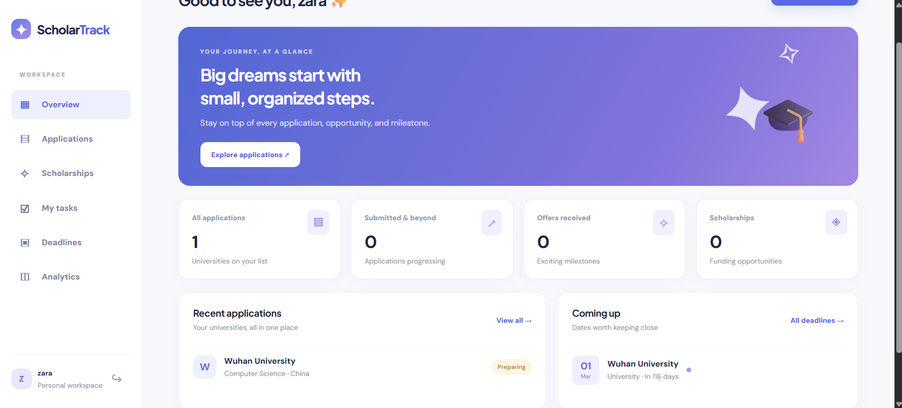
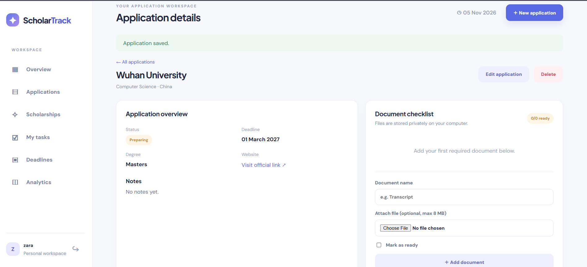
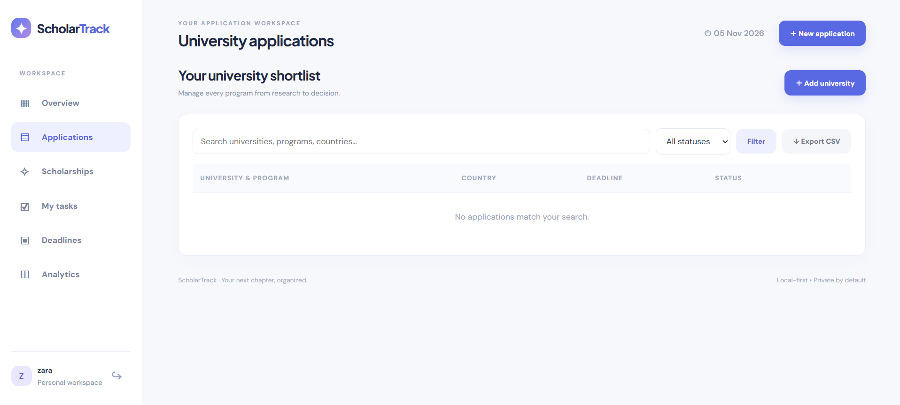
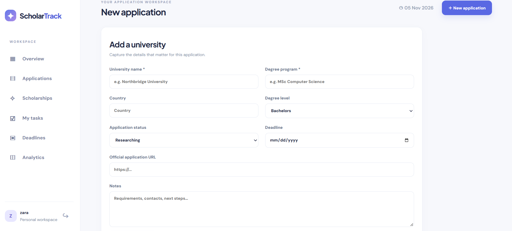
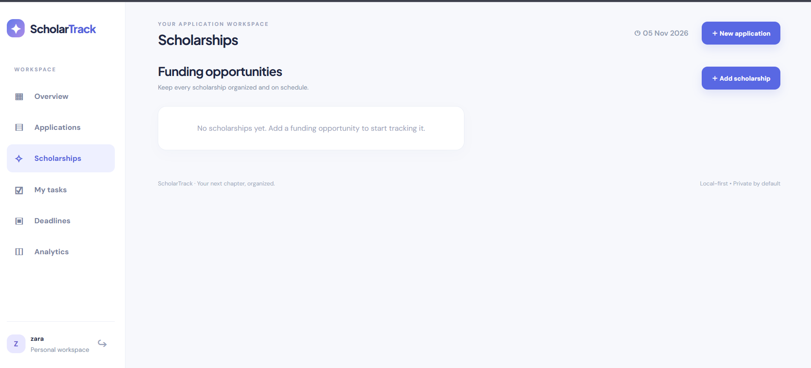
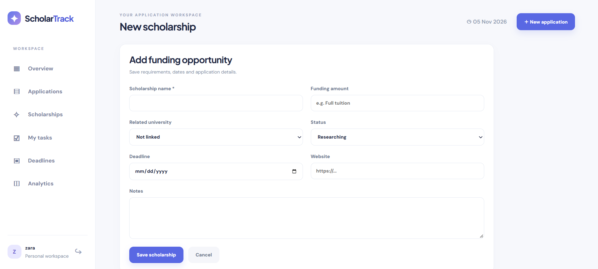
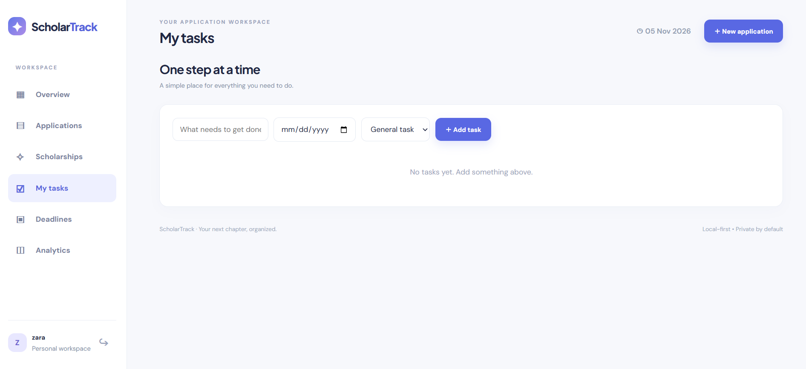
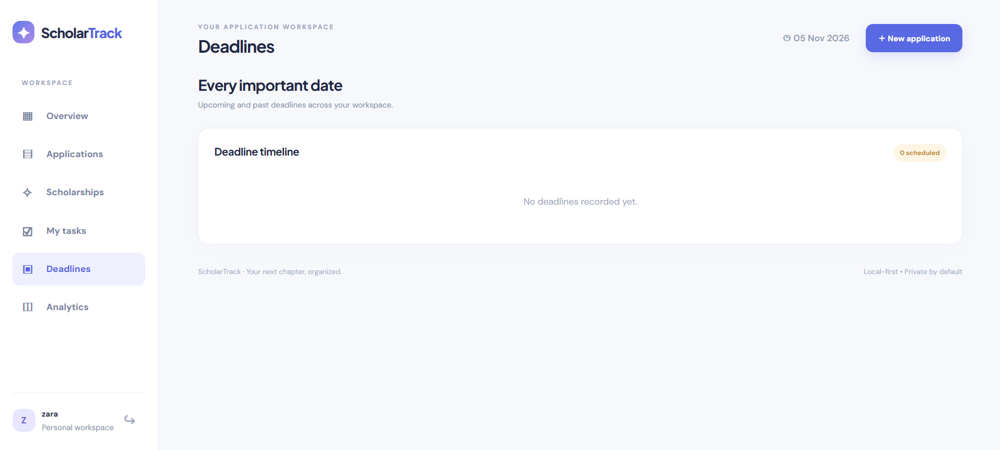
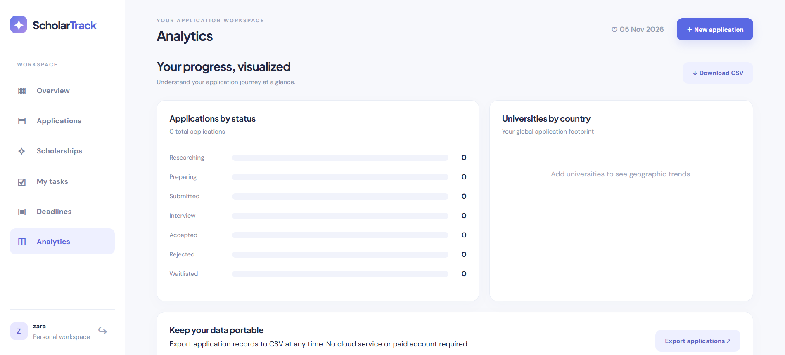
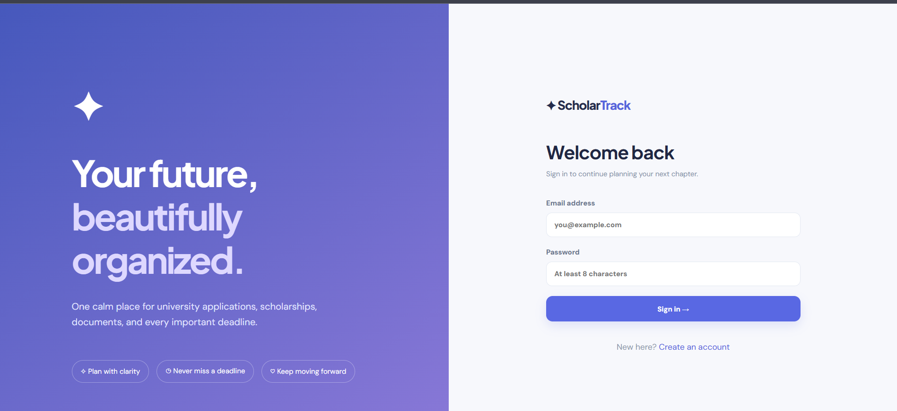

# ✦ ScholarTrack

### Your next chapter, organized.

A practical, local-first university and scholarship application manager built with **Python 3.10, Flask and SQLite**. Manage university applications, scholarship opportunities, documents, tasks, and deadlines in one polished workspace.

> **Portfolio project:** Runs locally on Windows. No paid API, machine learning training, or cloud account required.

## Features

- **Private accounts** with hashed passwords and per-user data isolation
- **Application management** — add, edit, delete, search, filter and track university applications
- **Scholarship tracking** — deadlines, amounts, status, links and optional university associations
- **Document vault** — upload supported files, maintain checklists, download files securely
- **Tasks and deadlines** — to-do list, overdue dates and chronological deadline timeline
- **Analytics** — application status and country breakdowns
- **CSV export** — download your application records
- **Fictional demo data** — populate a new account to explore the product
- **Responsive UI** — desktop sidebar and mobile-friendly layout

## Run on Windows (Python 3.10)

1. Install [Python 3.10](https://www.python.org/downloads/release/python-31011/) and ensure it is accessible on your PC.
2. Extract the ZIP to a normal folder (for example, Desktop/ScholarTrack).
3. Double-click **`START_HERE.bat`**.
4. Wait for the first-time dependency installation (requires internet), then open **http://127.0.0.1:5000**.
5. Create an account. Optionally click **Load demo workspace** to see fictional sample data.

**Important:** Keep the command window open while using the application. Press Ctrl+C to stop. On subsequent runs, double-click the launcher again.

### Run manually (Windows / macOS / Linux)

```bash
python -m venv .venv
# Windows: .venv\Scripts\activate
# macOS/Linux: source .venv/bin/activate
python -m pip install -r requirements.txt
python app.py
```

Visit `http://127.0.0.1:5000`.

## Test

```bash
python -m pytest -q
```

## Privacy and security

- Database and uploaded documents live inside the ignored `instance/` folder; **do not upload it to GitHub**.
- Passwords use Werkzeug password hashing; routes enforce user ownership; forms have CSRF protection; filenames are sanitized and stored under random names; uploads are limited to 8 MB and allowed extensions.
- Designed for **single-computer local use**. It is **not production-hardened** for internet-facing deployment. Before hosting publicly, configure a persistent `SCHOLARTRACK_SECRET`, HTTPS, secure cookies, rate limiting, backup strategy, and more rigorous file validation/malware scanning. The extension check alone is not sufficient to treat uploaded files as trusted.
- Do not store highly sensitive documents unless you are comfortable with local unencrypted disk storage. The app does not encrypt documents at rest.
- No email notifications are sent; reminders appear in the dashboard and deadline timeline.
- External Google Fonts are optional; the app falls back to system fonts offline.

## Project layout

```text
ScholarTrack/
├── app.py                 # Flask app, database models, routes
├── templates/             # Jinja pages
├── static/                # Responsive styles and JavaScript
├── tests/                 # Pytest workflow and access-control tests
├── START_HERE.bat         # Windows launcher
├── requirements.txt
├── .gitignore
├── LICENSE
└── README.md
```

## Screenshots

Screenshots below show ScholarTrack running locally on Windows. The interface includes a private workspace, application management, scholarship and task tracking, deadline timeline, document checklists, and analytics.

### Dashboard — application and deadline tracking


### University application details and document checklist


### University applications


### Create a university application


### Scholarships


### Add a scholarship


### Task management


### Deadline timeline


### Analytics


### Sign in


Additional screenshot: [Empty dashboard / new account](screenshots/02-dashboard-empty.png).

> The screenshots document the interface and selected workflows. Empty-state screenshots do not demonstrate completed scholarship, task, or document-upload workflows. Do not include actual personal documents, passwords, or private account data in a public repository.

## Technologies

Python 3.10 · Flask · Flask-Login · Flask-SQLAlchemy · Flask-WTF · SQLite · HTML · CSS · JavaScript · Pytest

## License

MIT — see [LICENSE](LICENSE).
